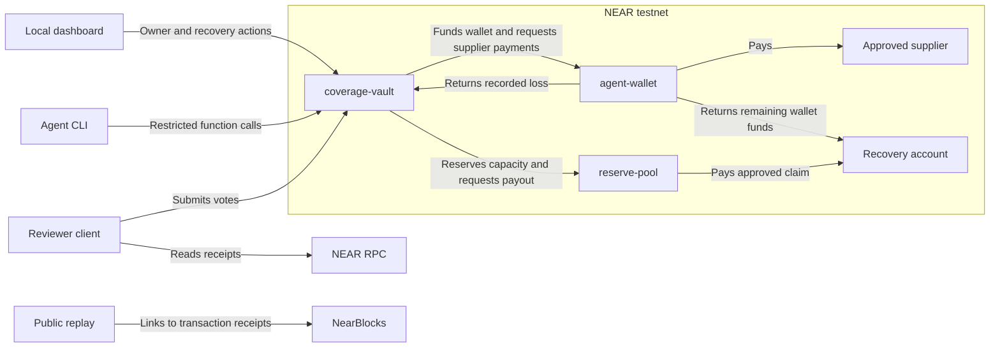

# AgSurance contracts

AgSurance uses three Rust contracts on NEAR testnet. The wallet holds the agent's spending funds. The vault manages coverage, claims, and recovery. The reserve holds the funds that pay approved claims and supports an optional capital pilot.

[Run the local demo](https://github.com/AgSurance/agsurance-fe#run-the-testnet-demo) · [Open the public replay](https://agsurance.github.io/agsurance-fe/)

## System diagram

The owner uses the local dashboard to buy a policy. The agent signs calls from its own runtime. The reviewer client reads transfer results through NEAR RPC. The vault counts the votes that reviewer accounts submit to the contract.



| Contract | What it controls |
| --- | --- |
| [`agent-wallet`](contracts/agent-wallet/src/lib.rs) | The spending balance, approved supplier, spending limit, and balance recovery. |
| [`coverage-vault`](contracts/coverage-vault/src/lib.rs) | Policy purchase, paid periods, agent access, and claim review. |
| [`reserve-pool`](contracts/reserve-pool/src/lib.rs) | Reserve funds, the amount set aside for each policy, and claim transfers. |

## Open a policy and grant access

A callback is a method that receives the result of an earlier call. The vault uses callbacks because NEAR processes calls between contracts in separate steps.

1. The owner attaches 0.36 NEAR to `buy_policy` and provides the supplier and spending limit. The vault asks the pool to set aside 0.40 NEAR through `reserve_policy`.
2. If the pool sets aside the funds, `finish_booking` calls `fund_checkout` to send 0.35 NEAR to the wallet. The vault keeps the 0.01 NEAR premium.
3. If wallet funding succeeds, `finish_checkout` activates coverage. If funding fails, the vault releases the allocation and refunds the owner.
4. The owner calls `connect_agent` with the public key and 0.10 NEAR. The vault creates an agent subaccount with a function-call access key.

The key permits `pay_supplier`, `pay_premium`, and `submit_claim` on the vault. The wallet enforces the supplier and the total spending limit for the policy. The vault checks the agent's access when it receives a request. The owner can call `revoke_agent` to remove that access.

## Review a claim and pay it

The test function `simulate_loss` transfers 0.30 NEAR to a fixed test recipient. The wallet records the loss after the transfer succeeds. When the agent calls `submit_claim`, the vault reads the recorded loss from the wallet.

The reviewer client reads the finalized transfer receipt through NEAR RPC. The vault compares the submitted evidence with the recorded loss and the policy's spending rules. It uses the transfer time to determine whether coverage was active. Two of three reviewers must submit matching votes on the same receipt. The contract uses those votes to approve or reject the claim.

After approval, `pay_claim` calls `settle_claim` on the pool. The pool pays the registered recovery account. `finish_transfer` records the transfer result. The vault marks the claim paid when `finish_payout` receives a paid result. If the transfer fails, the pool keeps the allocation for a retry. The pool records pending and paid transfers to prevent a second payout for the same policy. The standard 0.30 NEAR test loss pays 0.25 NEAR after the 0.05 NEAR deductible.

The registered recovery account calls payable `record_claim_recovery` to attach NEAR recovered from the incident after any external recovery costs. A deposit of 0.05 NEAR before payout reduces the test payout to 0.20 NEAR. A zero payout settles the claim and releases its allocation.

For deposits after payout, the vault first credits the recovery account for loss above the limit, then credits the reserve up to the payout, then credits the recovery account for the deductible. `distribute_claim_recovery` sends each credit to its fixed account and preserves the credit if the transfer fails. `claim_recovery` returns recorded totals by policy ID.

## Renew, recover, and release funds

The owner pays for the first coverage period during checkout. The agent can renew during the last day of a paid period or after a missed payment. A late payment starts coverage when the vault receives it. Each renewal costs 0.01 NEAR. The original policy limit applies across all four periods. The wallet's payable `top_up` method adds funds to the operating balance.

The registered recovery account calls `pause_wallet` to stop new spending and revoke the old agent grant. Scheduled transfers settle independently. To keep the wallet, register a fresh public key through `rotate_agent` with 0.10 NEAR. Call `resume_wallet` after the replacement grant is confirmed and any pending premium has settled.

To retire the wallet, call `recover_wallet` to move the operating balance to the registered recovery account. Starting the transfer disables resumption. The account can retry a failed transfer, file a claim for a covered loss before retirement, and use `refund_unused_premium` to recover a prepaid period that had yet to begin.

The filing window closes 48 hours after the policy ends or the wallet retires. After that deadline, anyone can call `close_policy` to release unused funds. An open claim keeps its allocation. If the reviewers do not reach two matching votes by the default 72-hour review deadline, `escalate_claim` records the escalation for the same panel.

A pool can serve several registered vaults. Each vault manages one wallet and one active policy. If the pool has less than it owes across all allocations, it blocks new allocations and payouts. Claim filing and review stay available. Testnet operators can use `quarantine_demo_collateral` to simulate a shortfall and `fund_reserve` to restore collateral.

## Optional capital pilot

Capital providers fund a cohort that the operator seals before issuing policies. The pool limits delegation to confirmed liquid assets left after policy allocations and the configured buffer. It restores staking principal to liquid assets after the returned funds reach the reserve and credits realized staking rewards separately.

After a policy ends and its claim or reserve allocation has settled, the vault can call `settle_earned_premiums`. The standard pilot configuration credits 20% cashback to the owner of a fully paid term without a coverage gap, then assigns 70% of the remaining earned premium to the cohort and the balance to the operator.

Providers claim their proportional principal and earnings after the cohort closes. The pool also tracks their shares of paid claims. The recovery, premium, and cashback flows passed in NEAR Sandbox. The staking flow used a simulated validator. [Pilot setup and operation](https://github.com/AgSurance/agsurance-fe#optional-capital-pilot)

## Build the contracts

Install the Rust toolchain. Run these commands from the `agsurance-sc` root.

```sh
rustup target add wasm32-unknown-unknown
cargo build --locked --release --target wasm32-unknown-unknown
```

The build writes the WebAssembly files to `target/wasm32-unknown-unknown/release`. Use a fresh deployment for this contract state. The frontend setup script deploys the three contracts to named testnet accounts without account access keys. Follow the [frontend setup instructions](https://github.com/AgSurance/agsurance-fe#run-the-testnet-demo).

## What to test

Use a fresh testnet setup. The [frontend instructions](https://github.com/AgSurance/agsurance-fe#live-regression-checks) include the command for live regression tests. These tests send transactions on NEAR testnet.

| Action | Expected result |
| --- | --- |
| Request payment to a supplier outside the policy. | The wallet rejects the request. The supplier receives no funds. |
| Pause the wallet, register a replacement key, and resume. | The old key loses access. The replacement can pay the supplier from the same wallet. |
| Approve a test claim with two matching votes. | The vault accepts a payout request. The pool pays the registered recovery account. |
| Record 0.05 NEAR recovered before settling a 0.30 NEAR loss. | The pool pays 0.20 NEAR, and the recovery account can collect the 0.05 NEAR deposit separately. |
| Call `pay_claim` again after the claim reaches `Paid`. | The vault rejects the request. The pool sends no second transfer. |
